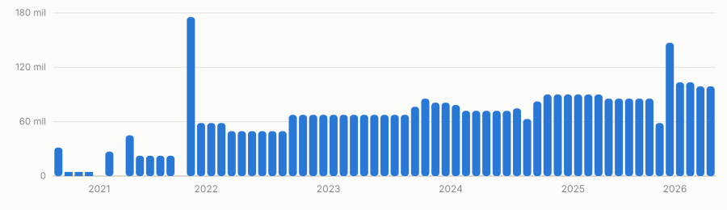
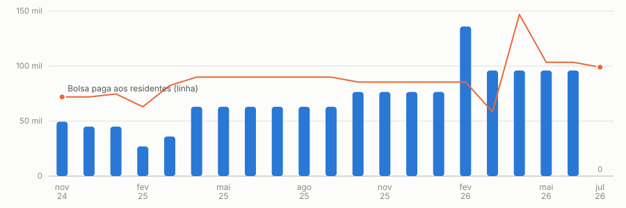

# Bolsa dos residentes de Medicina de Família e Comunidade — Santa Maria/RS


**O governo federal paga R$ 8.000 por residente de medicina. A bolsa que chega ao residente é R$ 4.500 —
o mesmo valor de 2021, sem reajuste.**

Este repositório reúne os documentos públicos e a análise que sustentam essa afirmação: os empenhos da
prefeitura, as planilhas oficiais de pagamento do Ministério da Saúde e o texto das normas aplicáveis.
Cada número tem link para a fonte primária.

👉 **[Abrir o dossiê completo (página navegável)](https://skabite.github.io/bolsa-residentes-santa-maria/)**

---

## O que os documentos mostram

| | |
|---|---|
| Residentes em 2026 | **22** — 15 na UFSM (7 R1 + 7 R2 + 1 ano adicional) e 7 na UFN |
| Bolsa paga pela prefeitura | **R$ 4.500** por residente/mês — inalterada desde o primeiro pagamento, em abril de 2021 |
| Custo mensal do programa (ago/2026) | **R$ 118.800** = R$ 99.000 de bolsas (22 × R$ 4.500) + R$ 19.800 de INSS patronal (20%) |
| Incentivo federal por residente de medicina (2026) | **R$ 8.000** — era R$ 4.500 até jan/2026 (Portaria GM/MS 10.193/2026) |
| Residentes que geram o incentivo federal | **12 dos 22** (mar–jun/2026) |
| Total repassado pela União ao município | **R$ 1.406.500** (nov/2024 a jul/2026) |
| Total pago em bolsas pela prefeitura no mesmo período | **R$ 1.843.050** |
| Competência **jul/2026** | incentivo federal transferido: **R$ 0,00** — o município pagou os R$ 99.000 mesmo assim |

### Bolsas pagas por mês (empenhos municipais)



### Incentivo federal recebido × bolsa paga (barras = federal, linha = municipal)



### Onde atuam os residentes da UFN (7 unidades)

Cruzamento das unidades informadas pelos residentes com o CNES — o nome da unidade indica a modalidade da equipe:

| Unidade | Nome no CNES | CNES | Modalidade |
|---|---|---|---|
| Passo das Tropas | UNIDADE ESF PASSO DAS TROPAS | 7091702 | eSF |
| Parque Pinheiro | UNIDADE ESF PARQUE PINHEIRO | 3290050 | eSF |
| Lídia | UNIDADE ESF LIDIA | 2242559 | eSF |
| Santa Marta | UNIDADE ESF NOVA SANTA MARTA | 9761306 | eSF |
| Binato | UNIDADE ESF ROBERTO BINATO | 2241307 | eSF |
| Alto da Boa Vista | UNIDADE ESF ALTO DA BOA VISTA | 3445453 | eSF |
| Itararé | UNIDADE DE SAUDE ITARARE **EAP** (há também a UNIDADE ESF ITARARE) | 2243547 | **eAP** |

O município tem no CNES **21 unidades “ESF” e 15 unidades “EAP”**. Seis das sete unidades da UFN são eSF —
que **é** modalidade elegível ao incentivo federal. Para a maior parte dos residentes da UFN, portanto, o
fator decisivo não é a modalidade da unidade, e sim **o cadastro individual** (código “05 – Residência” /
“01 – Residente”, vinculado a equipe com INE).

### O CNES mostra 26 médicos residentes registrados — o Ministério pagou por 12

Varredura das 36 unidades ESF e EAP do município na base pública do CNES (API de Dados Abertos do MS):

| Competência | Residentes registrados no CNES | Residentes pagos pelo MS |
|---|---|---|
| fev/2026 | 20 | 17 |
| jun/2026 | **26** | **12** |

Dos 26 registrados (jun/2026): **25 estão em equipes eSF** — que são elegíveis — e **1 em equipe eAP**
(não elegível). Todos têm vínculo "05 – Residência / 01 – Residente" e **todos têm INE** (vínculo a equipe).
Entre fevereiro e junho a turma virou: 4 residentes formaram e 10 entraram (turma de março) — e o número pago
pelo Ministério caiu de 17 para 12 exatamente no mês da troca, sem voltar depois. Detalhe por unidade em
[`dados/cnes_medicos_residentes_por_unidade.csv`](dados/cnes_medicos_residentes_por_unidade.csv) (sem nomes).

---

## Como conferir cada número

| A afirmação | Onde conferir |
|---|---|
| Valores, datas e quantos residentes foram pagos | [Portal da Transparência de Santa Maria → Despesa → Empenho](https://www.santamaria.rs.gov.br/transparencia/despesa/empenho) — filtre o ano e a unidade *Secretaria de Município da Saúde*, busque por `FOLHA PGTO COLETIVA` |
| Cada empenho citado | a coluna `link_detalhe` em [`dados/bolsa_empenhos_coletivos_2023_2026.csv`](dados/bolsa_empenhos_coletivos_2023_2026.csv) abre a página oficial do empenho |
| Valores que a União transferiu | [Painel público de pagamentos da APS](https://relatorioaps.saude.gov.br/gerenciaaps/pagamento) → aba **Residência** do arquivo Excel (dados em [`dados/incentivo_federal_residencia.csv`](dados/incentivo_federal_residencia.csv)) |
| Regras do incentivo federal | [Portaria GM/MS 10.193/2026](https://bvsms.saude.gov.br/bvs/saudelegis/gm/2026/prt10193_02_02_2026.html) (alterou os arts. 172-E a 172-I da Portaria de Consolidação GM/MS nº 6/2017) |
| Regra da bolsa municipal | Lei municipal nº 6.516, de 29/12/2020 |
| Cadastro de cada residente (equipe/INE) | [CNES](https://cnes.datasus.gov.br) — o incentivo federal só existe em equipes eSF, eSB, eMulti, eSFF/UBSF, eSFR, eCR e eAPP (**eAP não está na lista**) |
| Contribuição previdenciária em seu nome | [Meu INSS → Extrato de Contribuição (CNIS)](https://meu.inss.gov.br) |

---

## Conteúdo do repositório

```
index.html                                  dossiê navegável (mesmo conteúdo da página publicada)
relatorio.md                                relatório completo, com tabelas e ressalvas metodológicas
pedidos/
  pedido-prefeitura.md                      pedido de informação (LAI) para a prefeitura
  pedido-ministerio-saude.md                pedido de informação (LAI) para o Ministério da Saúde
dados/
  bolsa_residentes_por_mes.csv              bolsa municipal por mês (2021–2026), agregada
  bolsa_empenhos_coletivos_2023_2026.csv    empenho por empenho, com link para a página oficial
  bolsa_agregado_2021_2022.csv              2021–2022, quando os pagamentos eram individuais
  incentivo_federal_residencia.csv          o que o MS transferiu, por competência (aba “Residência”)
  grafico-*.svg                             gráficos usados neste README
scripts/                                    o que extrai e reconfere os dados (ver scripts/README abaixo)
```

**Sem dados pessoais.** Os pagamentos de 2021 e 2022 eram feitos em empenhos individuais, com o nome do
residente como credor. Esses registros aparecem aqui **apenas agregados por mês** — os nomes não são
reproduzidos. A partir de 2023 o credor é a “folha de pagamento coletiva”, sem nomes.

---

## Reconferir os dados você mesmo

```bash
# empenhos da Saúde de um ano inteiro (usa a API interna do portal, sem navegador)
python3 scripts/crawl_saude.py 2026

# detalhe de um empenho específico
python3 scripts/detalhe_empenho.py 25980/2025

# saiu empenho novo de bolsa de residentes?
python3 scripts/check_empenho_residentes.py 2026
```

Os scripts precisam apenas de `python3` com `requests` (e, para os relatórios em PDF do município,
`pdftotext`). Nenhum requer login, chave de API ou captcha.

---

## Ressalvas honestas

- **São dados de execução orçamentária** (empenhado, liquidado, pago) publicados pelo próprio município;
  não substituem os demonstrativos contábeis oficiais.
- **A leitura é factual, não acusatória.** O incentivo federal não é uma bolsa do profissional: é custeio
  transferido ao fundo municipal, e sustenta a maior parte da folha — inclusive dos residentes que não
  geram incentivo. O que este repositório documenta é a diferença entre o valor federal por residente
  credenciado (R$ 8.000) e a bolsa paga (R$ 4.500), e o reajuste anual previsto na lei municipal que
  nunca foi aplicado.
- **O ponto em aberto mais relevante** é a contagem: em junho e julho de 2026 o CNES registra 26 médicos
  residentes (25 em equipes eSF, com INEs **homologados** em portaria do MS), mas o Ministério pagou por
  **12** em mar–jun/2026 e **zero** em jul/2026. Foram descartadas, com documentos, as hipóteses de cadastro
  ausente, de INE ausente e de equipe não homologada. Restam, como explicação possível, a regularidade dos
  residentes/programas na **CNRM/CNRAPS** (art. 172-E, §4º, I), a **produção no SIAPS** (art. 172-H) ou a
  régua interna de contagem do Ministério. O caminho para fechar são os dois pedidos de informação em
  `pedidos/`, reescritos com essas perguntas específicas.
- **Contagens de equipe ≠ contagem de residentes.** O histórico de credenciamento do MS registra 16 equipes
  eAP aprovadas para o município e as planilhas de 2026 mostram 21 a 24 equipes eAP pagas por competência;
  quantos *residentes* estão lotados em cada equipe não é informação pública — vem da coordenação do
  programa e do CNES de cada profissional.

---

## Contribuições

Correções são bem-vindas — especialmente se você encontrar um empenho, planilha ou norma que contrarie
algo aqui. Abra uma *issue* com o link da fonte. Se você é residente da UFSM ou da UFN e quer conferir
seu próprio caso, os dois pedidos de informação em `pedidos/` estão prontos para protocolo.

Dados públicos, uso livre. Código dos scripts sob licença MIT (ver `LICENSE`).
