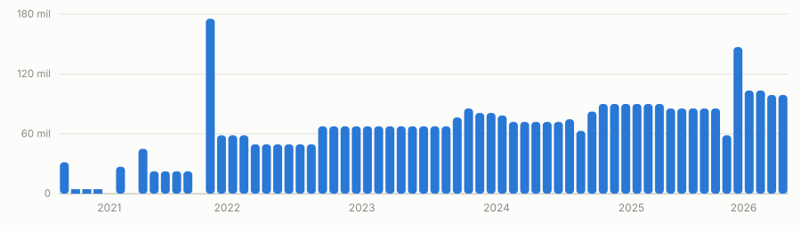
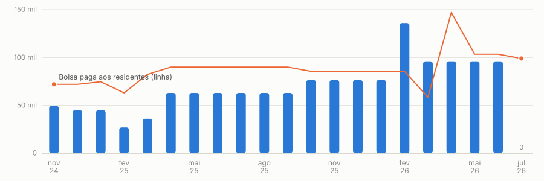

# Bolsa dos residentes de Medicina de Família e Comunidade — Santa Maria/RS


**A bolsa dos residentes de MFC de Santa Maria está em R$ 4.500 desde 2021. A lei municipal prevê correção
anual, que nunca foi aplicada. O incentivo federal que poderia pagar a correção existe, mas o Ministério da
Saúde está contando só parte dos residentes: 12 de cerca de 23 em mar–jun/2026, e nenhum de julho a setembro.**

**Novo em 12/11/2026.** O zero tem uma explicação provável, já corrigida no cadastro: até setembro, todos os médicos
residentes de Santa Maria estavam no CNES com o código de ocupação (CBO) 2231F9, "Médico residente". Desde a competência
jul/2026, o Ministério não contou esse código em nenhum dos 12 municípios comparados, e contou os outros (225142, 225130,
225170). Hoje os 23 estão no 225130. Se a leitura estiver certa, o repasse volta na parcela de dezembro de 2026 ou na de
janeiro de 2027. É leitura de dados oficiais, ainda sem confirmação do Ministério.

Este repositório reúne os documentos públicos e a análise que sustentam essa afirmação: os empenhos da
prefeitura, as planilhas oficiais de pagamento do Ministério da Saúde e o texto das normas aplicáveis.
Cada número tem link para a fonte primária.

👉 **[Abrir o dossiê (site navegável)](https://skabite.github.io/bolsa-residentes-santa-maria/)**

O site tem uma página por pergunta: [Início](https://skabite.github.io/bolsa-residentes-santa-maria/) ·
[Dá para pedir reajuste?](https://skabite.github.io/bolsa-residentes-santa-maria/reajuste.html) ·
[Onde trava a contagem](https://skabite.github.io/bolsa-residentes-santa-maria/contagem.html) ·
[Os números](https://skabite.github.io/bolsa-residentes-santa-maria/numeros.html) ·
[O que fazer](https://skabite.github.io/bolsa-residentes-santa-maria/fazer.html) ·
[Linha do tempo](https://skabite.github.io/bolsa-residentes-santa-maria/linha-do-tempo.html) ·
[Fontes](https://skabite.github.io/bolsa-residentes-santa-maria/fontes.html) ·
[Glossário](https://skabite.github.io/bolsa-residentes-santa-maria/glossario.html) ·
[Sobre](https://skabite.github.io/bolsa-residentes-santa-maria/sobre.html). Os trechos com fonte ficam sublinhados:
passe o mouse ou toque para ver a referência num balão e abrir o documento original.

---

## O que os documentos mostram

| | |
|---|---|
| Residentes | **22** em ago/2026 — 15 na UFSM e 7 na UFN (informação dos residentes; confere com os empenhos de ago/2026). Em set–out/2026, os empenhos declaram **21** |
| Bolsa paga pela prefeitura | **R$ 4.500** por residente/mês — inalterada desde o primeiro pagamento, em abril de 2021 |
| Custo mensal do programa (ago/2026) | **R$ 118.800** = R$ 99.000 de bolsas (22 × R$ 4.500) + R$ 19.800 de INSS patronal (20%). Em set–out/2026: **R$ 113.400** = R$ 94.500 (21 × R$ 4.500) + R$ 18.900 |
| Incentivo federal por residente de medicina **contado pelo Ministério** (2026) | **R$ 8.000** — era R$ 4.500 até jan/2026 (Portaria GM/MS 10.193/2026) |
| Residentes contados pelo Ministério | **12** de cerca de 23 pagos (mar–jun/2026) e **0** em jul, ago e set/2026 — com 18 vagas credenciadas |
| Código de ocupação (CBO) dos médicos residentes no CNES | **2231F9** em todos, de nov/2024 a set/2026; **225130** nos 23 do cadastro de 12/11/2026 |
| Média federal de fato por residente pago | **R$ 4.189** (mar–jun/2026) e **R$ 3.108** (nov/2024–set/2026) — abaixo da bolsa |
| Total repassado pela União ao município | **R$ 1.406.500** (nov/2024 a set/2026) |
| Total pago em bolsas pela prefeitura no mesmo período | **R$ 2.036.550** |
| Competências **jul, ago e set/2026** | incentivo federal transferido: **R$ 0,00** em cada uma; sem crédito desde 14/08/2026. As bolsas (R$ 99.000 em julho e agosto, R$ 94.500 em setembro) foram pagas normalmente |
| O que deixou de entrar em jul–set/2026 | cerca de **R$ 432.000** (estimativa: 18 contados × R$ 8.000 × 3 meses; pelo cadastro desses meses, 21 a 22 passavam nas regras visíveis) |
| Créditos do FNS em 2026 (ação 69166) | **R$ 749.500** em 8 parcelas, a última em 14/08/2026; não há parcelas 09, 10 e 11 nessa ação até 12/11/2026 (a 69182, de eSF/eAP, recebeu a 09 e a 10) |

### Dá para pedir reajuste?

Sim, com o argumento certo. A base não é "a prefeitura fica com R$ 3.500 por residente" — ela não fica: hoje
completa a folha com dinheiro próprio. A base é a lei (art. 3º, §1º da Lei 6.516/2020, correção anual nunca
aplicada) e uma proposta em que a prefeitura também ganha: regularizar a contagem. Com as 18 vagas credenciadas
contadas, o próprio incentivo pagaria uma bolsa de até **R$ 5.454** aos 22 residentes, com INSS. Referências
de correção: reajuste de 23,29% da bolsa federal em 2022 → **R$ 5.548**; IPCA de jan/2021 a set/2026 →
**R$ 6.227,96** (38,40%, conferido na série 433 do Banco Central). Detalhes, respostas da gestão e comparação com outros municípios na página.

### Bolsas empenhadas por mês (empenhos municipais)



*O gráfico vai até ago/2026; set e out/2026 estão na tabela e no gráfico do site.*

Todos os empenhos da bolsa são **da prefeitura**. A divisão em dois empenhos por mês (11 + 11 em ago/2026; 11 + 10 em set–out/2026)
é a fonte que ela declara — um com dinheiro do SUS federal que já está no Fundo Municipal (fonte 1600), outro
com impostos municipais (fonte 1500) — e não acompanha a contagem do Ministério.

### Incentivo federal recebido × bolsa paga (barras = federal, linha = municipal)



### Onde trava a contagem

Pela Portaria GM/MS 10.193/2026, só entra na conta o residente com matrícula regular na CNRM, cadastro
"05 – Residência / 01 – Residente" no CNES, vínculo a equipe elegível (eSF etc.), 40 h semanais na equipe e no
máximo 2 residentes de medicina por eSF — e o total não passa das vagas credenciadas (18). O cadastro no CNES é
responsabilidade da gestão municipal (art. 172-F, §5º); a situação na CNRM depende das COREMEs; o credenciamento,
do Ministério. Texto dos artigos em
[`dados/portaria_10193_2026_arts_172E_172IA.md`](dados/portaria_10193_2026_arts_172E_172IA.md).

**O código de ocupação.** O CNES guarda o cadastro de cada mês. De nov/2024 a set/2026, todos os médicos com vínculo de
residência nas 15 unidades tinham o CBO 2231F9 (Médico residente); com esse mesmo código o Ministério contou 17, depois 12
e, de julho a setembro, nenhum. Entre junho e julho o cadastro não mudou; o que mudou foi a contagem, e não só aqui: na
soma de 29 municípios consultados, os contados foram de 321 (jun) para 666 (jul) e 689 (ago–set), de cerca de 816 vagas,
depois de caírem de 605 (fev) para 321. Onde os residentes estavam em 225142, 225130 ou 225170, a contagem chegou ao teto
sem mudança no cadastro; onde estavam em 2231F9 (Santa Maria, Porto Alegre, Fortaleza, Ijuí), ficou em zero, e em Canoas
e Santos foi igual ao número de residentes em outro código. A portaria não cita CBO (o art. 58 da Portaria de Consolidação
nº 2 deixa a identificação dos residentes para regulamentação da SAPS, que não localizamos). Dados em
[`cnes_cbo_medicos_residentes_por_competencia.csv`](dados/cnes_cbo_medicos_residentes_por_competencia.csv),
[`cnes_cbo_comparacao_municipios_2026.csv`](dados/cnes_cbo_comparacao_municipios_2026.csv) e
[`residencia_outros_municipios_2026.csv`](dados/residencia_outros_municipios_2026.csv); para refazer,
`python3 scripts/cnes_cbo.py`.

No CNES de nov/2026 havia **23** médicos residentes em 15 unidades (eram 26 em junho; São José caiu de 5 para 3
e São João de 1 para 0), para 21–22 pagos pela prefeitura. Todos os 23 estão em alguma equipe; **4** cadastros
estão abaixo de 40 h e **uma** equipe (São Francisco, INE 0001662821) tem 3 residentes de medicina (acima do
limite) — em São José, a equipe que tinha 3 passou a 2. A contagem (03/11 e 12/11/2026) é agregada e cobre as 15
unidades. A causa da contagem baixa de mar–jun/2026, que aconteceu também em outros municípios, segue em aberto (pedido de
informação ao Ministério protocolado). Detalhe por unidade e por equipe em
[`cnes_residentes_por_unidade_nov_2026.csv`](dados/cnes_residentes_por_unidade_nov_2026.csv) e
[`cnes_residentes_por_equipe_nov_2026.csv`](dados/cnes_residentes_por_equipe_nov_2026.csv) (sem nomes).

Estimativa: aplicando ao cadastro de nov/2026 as regras visíveis no CNES (equipe eSF, 40 h na equipe, até 2 por eSF),
**17** dos 23 passam: 1 está em eAP, 4 abaixo de 40 h e 1 é excedente na equipe com 3. A mesma conta no cadastro de cada
mês dá 22 em junho e julho e 21 em setembro de 2026.
*Correção (12/11/2026): o texto anterior dizia "cerca de 18" e não descontava o residente em eAP.*

Risco para a bolsa: o art. 3º, §2º da Lei 6.516/2020 vincula a bolsa à pré-existência do repasse federal. Com o
incentivo de residência zerado de jul a set/2026 e sem crédito desde 14/08/2026, isso é um risco para a continuidade do
pagamento enquanto a contagem não voltar.

Residente em estágio externo só continua na conta se cumprir 40 h reais na equipe; como a residência pode ter até
60 h semanais, um estágio em parte da semana cabe. Com 22 pagos em ago/2026 e 18 vagas, até 4 podiam ficar fora da conta no
mesmo mês sem perda; com os 21 de set–out/2026, até 3, se os outros 18 estiverem em ordem (estimativa;
detalhes na página Contagem).

---

## Como conferir cada número

Guia completo, com o estado de cada verificação: [`verificacao.md`](verificacao.md).

| A afirmação | Onde conferir |
|---|---|
| Valores, datas e quantos residentes foram pagos | [Portal da Transparência de Santa Maria → Despesa → Empenho](https://www.santamaria.rs.gov.br/transparencia/despesa/empenho) — filtre o ano e a unidade *Secretaria de Município da Saúde*, busque por `FOLHA PGTO COLETIVA` |
| Cada empenho citado | a coluna `link_detalhe` em [`dados/bolsa_empenhos_coletivos_2023_2026.csv`](dados/bolsa_empenhos_coletivos_2023_2026.csv) abre a página oficial do empenho |
| Valores que a União transferiu | [Painel público de pagamentos da APS](https://relatorioaps.saude.gov.br/gerenciaaps/pagamento) → aba **Residência** do arquivo Excel (dados em [`dados/incentivo_federal_residencia.csv`](dados/incentivo_federal_residencia.csv)) |
| Créditos do incentivo de residência | [Consulta detalhada do FNS](https://consultafns.saude.gov.br/#/detalhada) → 2026 → Fundo a Fundo → bloco Manutenção → ação 69166. O relatório "Recursos recebidos" da prefeitura só traz o total da APS, sem separar a residência |
| Regras do incentivo federal | [Portaria GM/MS 10.193/2026](https://bvsms.saude.gov.br/bvs/saudelegis/gm/2026/prt10193_02_02_2026.html) (alterou os arts. 172-E a 172-I da Portaria de Consolidação GM/MS nº 6/2017) |
| Regra da bolsa municipal | Lei municipal nº 6.516, de 29/12/2020 |
| Cadastro de cada residente (equipe/INE) | [CNES](https://cnes.datasus.gov.br) — o incentivo federal só existe em equipes eSF, eSB, eMulti, eSFF/UBSF, eSFR, eCR e eAPP (**eAP não está na lista**) |
| Contribuição previdenciária em seu nome | [Meu INSS → Extrato de Contribuição (CNIS)](https://meu.inss.gov.br) |

---

## Conteúdo do repositório

```
index.html, reajuste.html, contagem.html,   páginas do site (as mesmas publicadas no GitHub Pages); as partes
numeros.html, fazer.html, fontes.html ...   comuns, gráficos e tabelas são montados por scripts/montar_site.py
assets/                                     estilo (dossie.css), comportamento (dossie.js) e fontes.js, gerado
relatorio.md                                relatório completo, com tabelas e ressalvas metodológicas
investigacao.md                             caderno de investigação: onde trava a contagem, hipóteses e próximos passos
verificacao.md                              como conferir cada afirmação em fonte pública, e o que ainda falta conferir
CLAUDE.md                                   contexto e regras para sessões de trabalho com o Claude
dados/
  bolsa_residentes_por_mes.csv              bolsa municipal por mês (2021–2026), agregada; INSS patronal
                                            só nos meses coletados (vazio = não coletado)
  inss_patronal_empenhos.csv                empenho do INSS patronal sobre as bolsas, com link oficial
  bolsa_empenhos_coletivos_2023_2026.csv    folha coletiva (mai/2023–out/2026), empenho por empenho, com link oficial
  bolsa_agregado_individuais_2021_2023.csv  abr/2021–abr/2023, quando os pagamentos eram individuais (só totais)
  incentivo_federal_residencia.csv          o que o MS transferiu, por competência (aba “Residência”)
  incentivo_federal_recebido_2026.csv       data e valor de cada crédito na conta do município (Lei 9.452/97)
  incentivo_federal_media_por_residente.csv média federal por residente pago pela prefeitura, por competência
  cnes_residentes_por_unidade_nov_2026.csv  médicos residentes no CNES por unidade em nov/2026 (sem nomes)
  cnes_residentes_por_equipe_nov_2026.csv   médicos residentes no CNES por equipe em nov/2026 (sem nomes)
  cnes_medicos_residentes_por_unidade.csv   contagem histórica por unidade (fev e jun/2026), com os INEs
  cnes_cbo_medicos_residentes_por_competencia.csv  CBO dos médicos residentes no CNES, mês a mês, e a contagem do MS
  cnes_cbo_comparacao_municipios_2026.csv   CBO no CNES × contagem do MS em Santa Maria e em 12 municípios
  residencia_outros_municipios_2026.csv     médicos credenciados e contados em 30 municípios (fev a set/2026)
  ines_homologacao_equipes_com_residentes.csv  homologação dos INEs com residentes
  brutos/2026-11-03/, brutos/2026-11-12/    respostas brutas do relatorioaps e do FNS usadas em cada coleta
  portaria_10193_2026_arts_172E_172IA.md    texto dos arts. 172-E a 172-I-A, transcrito do DOU de 02/02/2026
  fontes.json                               as fontes do site: o que cada uma prova, links e estado de conferência
  glossario.json                            os termos do glossário (balões e página Glossário)
  situacao_dos_dados.csv                    até quando vai cada base e o que falta incluir
  grafico-*.svg                             gráficos usados neste README
scripts/                                    o que extrai e reconfere os dados e monta o site (ver scripts/README.md)
```

**Sem dados pessoais.** De abr/2021 a abr/2023 os pagamentos eram feitos em empenhos individuais, um por
residente. Esses registros aparecem aqui **apenas agregados por mês**, sem link para cada empenho — os nomes
não são reproduzidos. A partir de mai/2023 o pagamento sai numa “folha de pagamento coletiva”, sem nomes.
*Correção (19/10/2026): o texto anterior dizia “a partir de 2023”; jan–abr/2023 ainda eram empenhos individuais.*

---

## Reconferir os dados você mesmo

```bash
# empenhos da Saúde de um ano inteiro (usa a API interna do portal, sem navegador)
python3 scripts/crawl_saude.py 2026

# detalhe de um empenho específico
python3 scripts/detalhe_empenho.py 25980/2025

# saiu empenho novo de bolsa de residentes?
python3 scripts/check_empenho_residentes.py 2026

# CBO dos médicos residentes no CNES, por competência (contagem agregada, sem nomes)
python3 scripts/cnes_cbo.py santa-maria 202606 202607 202609 atual

# depois de mudar um CSV, dados/fontes.json ou uma página: refaz gráficos e tabelas e confere fontes e links
python3 scripts/montar_site.py
```

O passo a passo para baixar o que falta (planilha do Ministério, empenhos novos, CNES), com os links, está em
[`verificacao.md`](verificacao.md#atualizar-os-dados).

Os scripts precisam apenas de `python3` com `requests` (e, para os relatórios em PDF do município,
`pdftotext`). Nenhum requer login, chave de API ou captcha.

---

## Ressalvas honestas

- **São dados de execução orçamentária** (empenhado, liquidado, pago) publicados pelo próprio município;
  não substituem os demonstrativos contábeis oficiais.
- **A leitura é factual, não acusatória.** O incentivo federal não é uma bolsa do profissional: é custeio
  transferido ao fundo municipal, e hoje **não cobre** a folha: em média entrou R$ 4.189 por residente pago
  em mar–jun/2026, contra R$ 5.400 de custo (bolsa + 20% de INSS patronal). O que este repositório documenta
  é a diferença entre o valor federal por residente contado (R$ 8.000) e a bolsa paga (R$ 4.500), a contagem
  baixa do Ministério (12 de cerca de 23, e 0 de julho a setembro) e o reajuste anual previsto na lei municipal que nunca foi aplicado.
  Com os 18 credenciados contados, o próprio incentivo pagaria a folha e sobrariam ≈ R$ 25 mil/mês.
- **O ponto em aberto mais relevante** é a confirmação do Ministério sobre o CBO (ver "Onde trava a contagem" acima e
  [`investigacao.md`](investigacao.md)): se ele deixou de contar o 2231F9 em jul/2026, em que ato, e se jul–set serão
  reprocessados. A relação entre CBO e contagem é uma leitura de dados oficiais numa amostra de 12 municípios, não uma
  regra publicada. Foram descartadas, com documentos, as hipóteses de cadastro ausente, de INE ausente, de equipe não
  homologada e de mudança no cadastro entre junho e julho. Pedido de informação ao Ministério protocolado no Fala.BR.
- **Iniciativa pessoal e independente**: não representa nem tem endosso da UFSM, da UFN ou da Prefeitura.
  Sem nomes, CPF, cartão SUS ou dados bancários; residentes só em números agregados. Pedidos de correção ou de
  retirada: abra uma *issue*. Uma resposta da Secretaria de Saúde ou das COREMEs será publicada com o mesmo
  destaque.
- **Contagens de equipe ≠ contagem de residentes.** O histórico de credenciamento do MS registra 16 equipes
  eAP aprovadas para o município e as planilhas de 2026 mostram 21 a 24 equipes eAP pagas por competência;
  quantos *residentes* estão lotados em cada equipe não é informação pública — vem da coordenação do
  programa e do CNES de cada profissional.

---

## Contribuições

Correções são bem-vindas — especialmente se você encontrar um empenho, planilha ou norma que contrarie
algo aqui. Abra uma *issue* com o link da fonte. Se você é residente da UFSM ou da UFN e quer conferir
seu próprio caso, o caminho é: (1) CNES, para ver seu registro e sua equipe; (2) Meu INSS/CNIS, para a
contribuição previdenciária; (3) pedido de acesso à informação ao Ministério da Saúde (Fala.BR) e à
prefeitura (e-SIC), perguntando a contagem do incentivo por competência e por equipe.

Dados públicos, uso livre. Textos sob [CC BY 4.0](https://creativecommons.org/licenses/by/4.0/deed.pt-br) (cite a fonte);
código dos scripts sob licença MIT (ver `LICENSE`).
